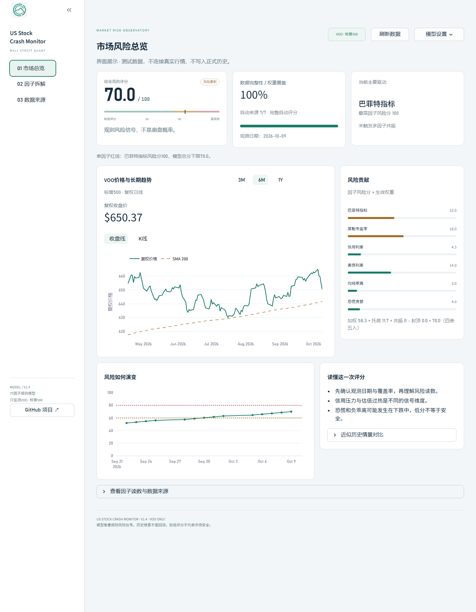

<p align="center">
  
</p>

<h1 align="center">US Stock Crash Monitor</h1>

<p align="center">An explainable market-risk dashboard for the S&amp;P 500.</p>

<p align="center">
  
  
  <a href="LICENSE"></a>
  
</p>

<p align="center"><a href="README.md">简体中文</a> · <b>English</b> · <a href="docs/UI_REDESIGN.md">UI design</a> · <a href="docs/FEATURE_OPTIONS.md">Roadmap</a></p>


## Overview

US Stock Crash Monitor combines valuation, credit, Treasury, technical, and sentiment readings into a transparent rule-based score. Built with **Python, Streamlit, and Plotly**, it helps researchers monitor VOO market signals and understand which inputs drive a reading.

The project favors explainability: input sources, available-weight coverage, factor contributions, and nonlinear adjustments are visible together.

**Version v1.4 · 2026-10-10 · Light UI / VOO only** ｜ [中文](README.md)

The score measures model signals, not crash probability. Historical comparisons are approximate scenarios, not validated backtests.

## Features

- **Six-factor monitoring** — Buffett indicator, Shiller CAPE, high-yield credit spread, Treasury spread, SMA200 deviation, and Fear & Greed.
- **Explainable scoring** — normalized weights, credit percentiles, resonance alerts, redline floors, and contribution charts.
- **VOO market view** — adjusted daily prices, moving averages, and volume, with separate market and macro caches.
- **Explicit data quality** — missing readings remain missing; manual overrides and demo data are clearly marked.
- **Local trend history** — atomic records separated by market date, model version, weights, and scoring method.
- **Historical scenarios** — inspect approximate stress inputs under your chosen weights; these are not backtests.

## Interface

The application uses a **light research dashboard** and monitors **VOO (S&P 500 ETF)** only. Risk, coverage, and primary drivers appear first; the price chart, contribution list, and lower trend/notes row share a light theme. Weights, connections, and manual calibration live in the top settings popover, with separate factor and source pages.



The screenshot uses labeled test fixtures to illustrate the interface. In normal use, source status reflects fetch results. Unavailable prices are clearly marked as demo data and excluded from technical scoring and official history. An [interactive layout example](docs/ui-proposal.html) is also available with synthetic data.

## Quick start

Requires Python 3.10 or later.

```bash
git clone https://github.com/middletoo/US_Stock_Crash_Monitor.git
cd US_Stock_Crash_Monitor
python -m pip install -r requirements.txt
python -m streamlit run app.py
```

Open [the local dashboard](http://localhost:8501). Optionally copy `.env.example` to `.env` and configure `FRED_API_KEY` for high-yield credit history and Treasury fallback data. The app reads `.env` from its own directory; Git ignores this file.

## v1.4 changes

- Missing readings stay missing. Prefilled manual values are used only after explicitly enabling an override.
- Zero-weight factors do not affect weighted scores, resonance, or redline floors. All-zero weights restore the defaults.
- Score, effective weights, and contributions come from the same model output. Contributions also explain floor, resonance, and cap adjustments.
- ETF and macro data have separate bounded 30-minute caches. Independent macro sources run concurrently.
- Disabling automation skips macro requests. Missing 10Y yields independently execute the backup chain.
- The Treasury backup reads only the latest 20 Eastmoney observations, removing the AkShare dependency used to download years of data.
- TLS validation is enabled. Proxy settings are isolated per call, cleared explicitly, and never written to process proxy environment variables.
- Credit history accepts arrays, filters invalid samples, and uses midranks for ties. The label shows the actual sample count.
- Fewer than 200 valid daily bars cannot produce a technical score. Demo candles use a fixed seed and consistent OHLC/volume.
- History uses market observation dates, model versions, and scoring profiles, with thread/process locks and atomic replacement. Legacy records are preserved but excluded from current-profile trends.

## Sources and fallback

| Reading | Primary source | Fallback |
|---|---|---|
| ETF adjusted daily bars / SMA200 | yfinance | Clearly marked demo chart, excluded from technical scoring/history |
| 10Y Treasury yield | yfinance `^TNX` | CNBC → Eastmoney → FRED → missing/manual |
| 2Y Treasury yield | CNBC | Eastmoney → FRED → missing/manual |
| High-yield OAS | FRED `BAMLH0A0HYM2`, key required | Missing/manual; percentiles when sufficient history exists |
| Buffett indicator | GuruFocus | Missing/manual |
| Shiller CAPE | Multpl | Missing/manual |
| Fear & Greed | CNN dataviz | Missing/manual |

FRED `NCBEILQ027S` covers nonfinancial corporate equity liabilities, not total listed market capitalization. A same-quarter equity/GDP proxy may be displayed when GuruFocus fails, but it is not calibrated with a fixed scalar or used as the Buffett score. [FRED definition](https://fred.stlouisfed.org/series/NCBEILQ027S)

Sources may rate-limit requests, reject access, or change markup. These are adjusted daily prices, not live intraday quotes.

## Use and history

Adjust weights for the fixed VOO monitor. Missing enabled factors are excluded and available factors are renormalized; the dashboard reports original-weight coverage and labels the result provisional.

Only real market data with complete enabled factors and no manual overrides are recorded. Records are grouped by asset, market date, model version, normalized weights, and credit scoring method. The current profile's trend excludes legacy or incompatible profiles; the CSV retains them. Repeated unchanged records do not rewrite the file.

Default weights: Buffett 15%, Shiller 20%, credit 20%, yields 20%, technical 15%, sentiment 10%. Shared display bands are `<60`, `60–<80`, and `≥80`.

Historical scenario comparisons use absolute credit thresholds on both sides. The main score can use credit percentiles, so the comparison's current value may differ from the main risk summary.

## Code and validation

`app.py` handles UI and caching; `data_fetcher.py` handles requests and fallbacks; `risk_model.py` owns scoring; `risk_history.py` persists history; `charts.py` constructs the price chart.

```powershell
python -m pip install -r requirements-dev.txt
python -m pytest -q
python -m ruff check .
python data_fetcher.py
```

The source probe reads the FRED key from `.env`, avoiding command-line credentials.

## Limits

The price and sentiment rules emphasize overheating and do not fully measure ongoing drawdown stress. A low score cannot establish market safety. A flat positive yield curve cannot prove a previous inversion without history. Valuation, credit, and sentiment describe market-wide conditions rather than ETF-specific fundamentals. History accumulates only while the app runs with complete readings; scheduled collection and notifications have not been added.

See the Chinese [review](docs/2026-10-10-project-review.md) and [feature options](docs/FEATURE_OPTIONS.md) for findings and proposed extensions.

For programming education and quantitative research. No investment advice. [MIT license](LICENSE).

## Roadmap and contributing

Possible next steps include point-in-time backtesting, separate drawdown-stress scoring, scheduled collection, yield-curve state history, better source resilience, and research exports. These are proposals, not shipped features; see the [feature options](docs/FEATURE_OPTIONS.md).

Bug reports and improvements are welcome. Include the observed behavior, reproduction steps, and dependency versions. Keep credentials out of issues and commits; run tests and lint before submitting a change.


Use your GitHub-provided `noreply` address for commit author and committer metadata. Enable email privacy and private-email push blocking in [GitHub email settings](https://github.com/settings/emails).

## Brand asset

The radar and market-line logo represents monitoring changing market signals. It is generated artwork stored at [assets/logo.png](assets/logo.png); its prompt and usage notes are in [the brand document](assets/BRAND.md).
