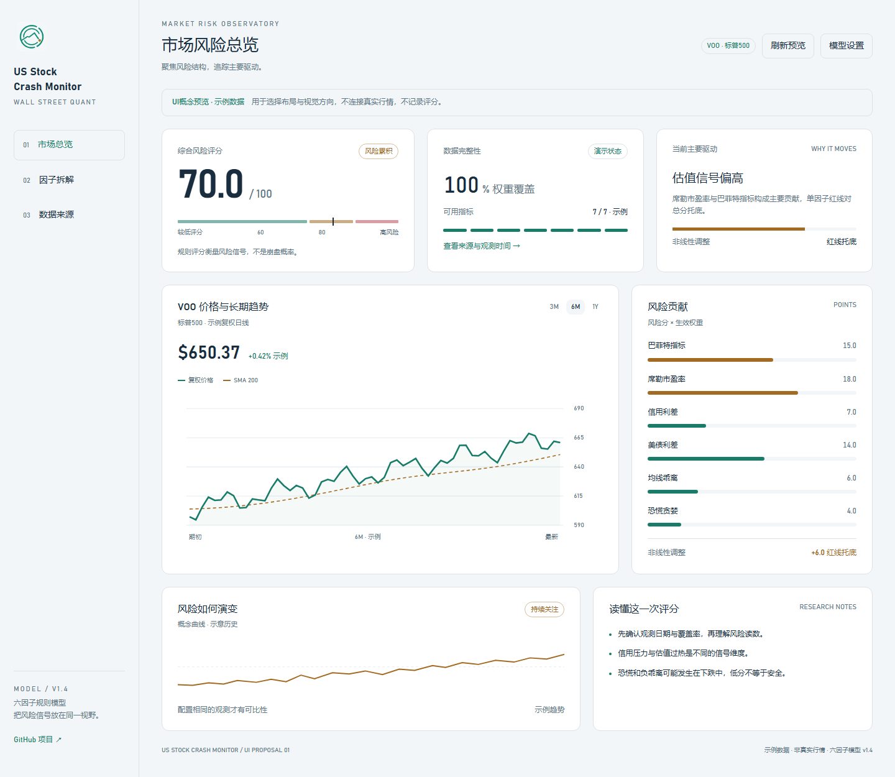

# 浅色界面设计说明

已经在现有Streamlit应用中落地：按用户提供的排版参考做成浅色，只监测VOO，统一图表和数据状态。没有更换后端或引入新的前端构建链路。文档截图使用明确标注的测试数据，真实来源失败状态另由回归与连通性检查验证。

## 已完成

- 大数字风险摘要和分段风险刻度替代半圆仪表盘，首先展示评分是否完整。
- 首屏三块摘要显示风险分、数据权重覆盖率与主要驱动；VOO价格置于行情区。
- 页面分为市场总览、因子拆解、数据来源；六因子读数、权重与贡献使用统一行表。
- 模型权重、数据连接和手动校准移入顶部设置弹层；侧栏只保留导航与模型说明。
- 默认收盘线配合长期均线，保留K线与成交量切换；行情窗口支持3M/6M/1Y。风险贡献采用轻量条形列表，其他图表共用浅色Plotly模板。
- 删除标的切换，所有页面与文档固定围绕VOO；不新增其他ETF。
- Logo接入侧栏、浏览器图标、中英文README和布局示意。
- 缺失数据、手动校准、模拟行情明确标注，不生成虚假的正式历史。

## 视觉规范

| 元素 | 规范 |
|---|---|
| 页面背景 | 浅灰蓝 `#F3F6F8` |
| 面板 | 白色 `#FFFFFF`，12px圆角与细边框 |
| 正文 | 深蓝灰 `#192D3E` |
| 辅助文字 | `#607686` |
| 品牌强调 | 深青绿 `#187C68` |
| 风险累积 | 琥珀 `#A36B22` |
| 高风险 | 红 `#BD4C57` |
| 数字 | Bahnschrift与等宽数字排列 |
| 图表 | 透明背景、低对比网格，绿色上涨、红色下跌 |
| 风险区间 | `<60`、`60–<80`、`≥80`，颜色同时配合文字 |
| 动效 | 160ms轻量反馈，尊重减少动画设置 |

`.streamlit/config.toml`设置默认浅色；`assets/app.css`调整页面；`ui_theme.py`统一Plotly样式。

## 布局示意

[可交互示意](ui-proposal.html)同样固定VOO与浅色，可操作页面导航、图表范围和示例权重。全部使用模拟数据，不能作为真实行情或历史回测。

## 验收

回归测试覆盖真实数据完整、缺失、手动、演示、全零权重、页面导航与浅色图表。浏览器检查桌面与390px手机宽度，确认页面无水平溢出、图表可见、控件有反馈。历史不足时显示真实空状态，不画示意曲线冒充观测。
